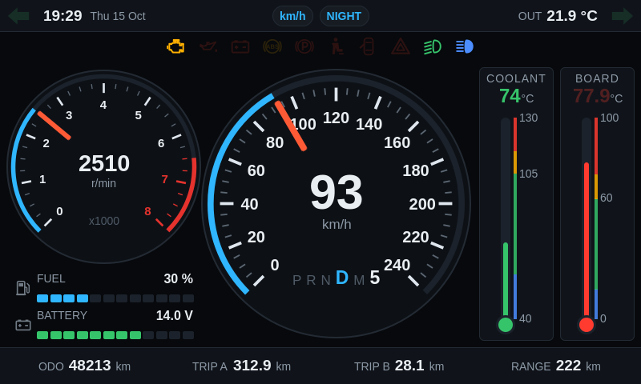
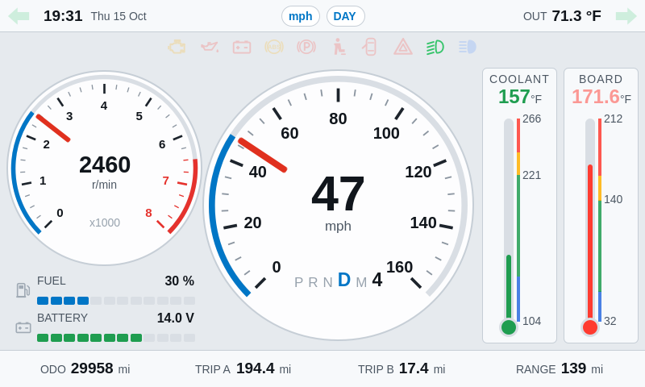
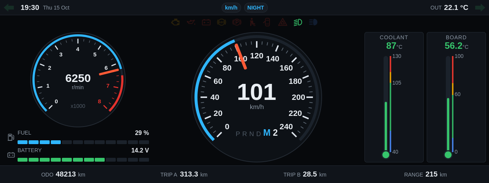

# Qt Quick Instrument Cluster

An automotive instrument cluster for embedded Linux, written in **Qt 6 / Qt Quick
(QML) + C++17**. Designed for an **800×480** display; the layout scales to any
resolution.



| Day theme, imperial units | Wide 1280×480 layout |
|---|---|
|  |  |

## Features

- Speedometer, tachometer, fuel, battery, coolant and board temperature
- Gear indicator, turn signals and warning telltales
- Odometer, trip A/B, range, clock and outside temperature
- Day/night theme and km/h ↔ mph units
- Built-in demo simulator (remove with `-DDASHBOARD_ENABLE_SIMULATOR=OFF`)

## Build

Requires Qt ≥ 6.5 (Quick, Quick Shapes, SVG plugin) and CMake ≥ 3.21.

```sh
cmake -S . -B build -DCMAKE_BUILD_TYPE=Release
cmake --build build
./build/dashboard --windowed
```

## Usage

```sh
dashboard [--windowed] [--no-simulator] [--day] [--imperial]
```

The platform comes from `QT_QPA_PLATFORM` (e.g. `wayland`) and the renderer
from `QT_QUICK_BACKEND` (unset = GPU, `software` = CPU).

**Controls:** **U** = units · **T** = theme · long-press TRIP A/B = reset ·
**Ctrl+Q** = quit

## Connecting real data

- **Temperature sensor:** implement `TemperatureProvider::readSensor()` in
  `src/temperatureprovider.cpp`, or call
  `TemperatureProvider::instance()->setTemperature(celsius)` from any thread.
- **Other signals (CAN, GPIO, …):** call the `VehicleData` setters
  (`setSpeed()`, `setRpm()`, …) from the GUI thread.
